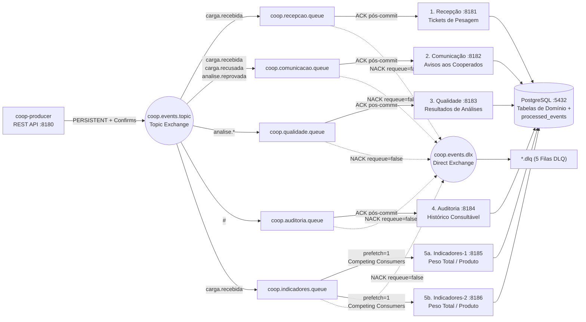

# Cooperativa Agrícola — Mensageria Orientada a Eventos com RabbitMQ

> **Disciplina:** Sistemas Distribuídos e Cloud Computing — Tema 08  
> **Tecnologias:** Java 21, Spring Boot 4.2.0, Spring AMQP (RabbitMQ), PostgreSQL 16, Flyway, Docker Compose  

## Integrantes do Grupo (5 integrantes)

- `[Integrante 1 — Nome Completo / RA]`
- `[Integrante 2 — Nome Completo / RA]`
- `[Integrante 3 — Nome Completo / RA]`
- `[Integrante 4 — Nome Completo / RA]`
- `[Integrante 5 — Nome Completo / RA]`

---

## Visão Geral e Arquitetura

O sistema modela o fluxo de **recepção de cargas agrícolas** e **análise de qualidade de lotes** em uma cooperativa. A aplicação produtora (`coop-producer`) publica fatos do domínio em uma **Topic Exchange** (`coop.events.topic`) no RabbitMQ, e cinco responsabilidades de consumo independentes reagem aos eventos conforme regras de roteamento declarativas.



---

## Módulos do Repositório

| Módulo / Arquivo | Papel | Porta HTTP |
|---|---|---|
| `coop-common` | Contrato JSON (`CooperativeEvent`, `EventPayload`), constantes de topologia, `CooperativeRabbitConfig`, `ProcessedEventRepository`, `ReliableEventConsumer` e migração Flyway `V1__init_schema.sql` | — |
| `coop-producer` | API REST para disparo dos 4 eventos obrigatórios, eventos customizados e republicação idempotente por `eventId` | `8180` |
| `coop-consumer-recepcao` | Registra ticket de pesagem (`lote` e `pesoLiquidoKg`) | `8181` |
| `coop-consumer-comunicacao` | Registra avisos de recebimento, recusa de carga e reprovação de análise | `8182` |
| `coop-consumer-qualidade` | Registra resultados das análises da família `analise.*` (incluindo novos fatos da família) | `8183` |
| `coop-consumer-auditoria` | Mantém histórico completo consultável por identificador, tipo e intervalo de horário | `8184` |
| `coop-consumer-indicadores` | Soma peso líquido recebido por produto; executa em **2 instâncias simultâneas** (`indicadores-1` e `indicadores-2`) | `8185` / `8186` |
| `rabbitmq/` | `rabbitmq.conf` + `definitions.json` para configuração 100% reproduzível do broker | `5672` / `15672` |
| `scripts/` | Scripts PowerShell para subir, parar/religar comunicação e validar todos os cenários | — |

---

## Matriz de Roteamento (Evento × Consumidor)

| Evento | `eventType` | `routingKey` | 1. Recepção (`carga.recebida`) | 2. Comunicação (`carga.recebida`, `carga.recusada`, `analise.reprovada`) | 3. Qualidade (`analise.*`) | 4. Auditoria (`#`) | 5. Indicadores (`carga.recebida`) |
|---|---|---|:---:|:---:|:---:|:---:|:---:|
| **Carga recebida** | `CARGA_RECEBIDA` | `carga.recebida` | **SIM** | **SIM** | NÃO | **SIM** | **SIM** *(1 instância)* |
| **Carga recusada** | `CARGA_RECUSADA` | `carga.recusada` | NÃO | **SIM** | NÃO | **SIM** | NÃO |
| **Análise aprovada** | `ANALISE_APROVADA` | `analise.aprovada` | NÃO | NÃO | **SIM** | **SIM** | NÃO |
| **Análise reprovada** | `ANALISE_REPROVADA` | `analise.reprovada` | NÃO | **SIM** | **SIM** | **SIM** | NÃO |
| *Novo evento da família* (ex.) | `ANALISE_REAVALIADA` | `analise.reavaliada` | NÃO | NÃO | **SIM** | **SIM** | NÃO |
| *Evento sem regra específica* (ex.) | `FATURAMENTO_EMITIDO` | `faturamento.emitido` | NÃO | NÃO | NÃO | **SIM** | NÃO |

---

## Contrato JSON dos Eventos

Todos os eventos seguem o envelope `CooperativeEvent`:

```json
{
  "eventId": "f47ac10b-58cc-4372-a567-0e02b2c3d479",
  "eventType": "CARGA_RECEBIDA",
  "routingKey": "carga.recebida",
  "occurredAt": "2026-11-24T13:30:00Z",
  "payload": {
    "lote": "LOTE-2026-001",
    "cooperado": "Fazenda Boa Vista",
    "produto": "SOJA",
    "pesoLiquidoKg": 18500.50,
    "motivo": null,
    "detalhes": {
      "origem": "unidade-central"
    }
  }
}
```

- **`eventId`**: Identificador único do evento (UUID gerado automaticamente ou informado na requisição para repetir intencionalmente uma publicação no teste de duplicidade).
- **`eventType`**: Tipo do fato do domínio (`CARGA_RECEBIDA`, `CARGA_RECUSADA`, `ANALISE_APROVADA`, `ANALISE_REPROVADA` ou novos tipos futuros).
- **`routingKey`**: Chave hierárquica `<familia>.<evento>` usada pela `TopicExchange`.
- **`occurredAt`**: Carimbo temporal ISO-8601 UTC da ocorrência.
- **`payload`**: Dados necessários aos efeitos de cada consumidor (`lote`, `cooperado`, `produto`, `pesoLiquidoKg`, `motivo` e mapa extensível `detalhes`).

Mais detalhes sobre as decisões arquiteturais, comparação `Topic × Direct × Fanout`, comportamento para eventos novos, confirmação manual e idempotência estão documentados em [`docs/arquitetura-e-justificativa.md`](docs/arquitetura-e-justificativa.md).

A explicação aprofundada de todo o ecossistema e da lógica interna de cada componente (banco de dados, RabbitMQ, produtor, painel web, ACK pós-commit e concorrência/idempotência) está em [`docs/ecossistema-e-logica-detalhada.md`](docs/ecossistema-e-logica-detalhada.md).

---

## Como Executar

### Opção A — Tudo no Docker Desktop (recomendado)

**Pré-requisito:** apenas **Docker Desktop** em execução (portas livres: `5672`, `15672`, `5432`, `8180`–`8186`).

```powershell
# Compila, cria as imagens e sobe os 9 containers (RabbitMQ, PostgreSQL, produtor e 6 consumidores)
docker compose up -d --build --wait
```

- **Painel Web (Disparo + Matriz + Monitoramento ao Vivo):** http://localhost:8180
- **RabbitMQ Management UI:** http://localhost:15672 (usuário `coop`, senha `coop`)
- **Produtor REST API:** http://localhost:8180/api/eventos
- **Consumidores:** Recepção (`:8181`), Comunicação (`:8182`), Qualidade (`:8183`), Auditoria (`:8184`), Indicadores-1 (`:8185`), Indicadores-2 (`:8186`)
- A topologia (`coop.events.topic`, `coop.events.dlx`, 5 filas principais, 5 DLQs e 12 bindings) é carregada automaticamente via [`rabbitmq/definitions.json`](rabbitmq/definitions.json) e também declarada de forma idempotente em [`CooperativeRabbitConfig.java`](coop-common/src/main/java/com/example/cooperativa/common/messaging/CooperativeRabbitConfig.java).

Para encerrar os containers:
```powershell
docker compose down
```

### Opção B — Executar aplicações Java localmente (apenas broker e banco no Docker)

**Pré-requisitos:** **Java 21** e **Docker Desktop**.

```powershell
docker compose up -d --wait rabbitmq postgres
.\mvnw.cmd clean package -DskipTests
.\scripts\start-all.ps1
```

**Ou iniciando cada aplicação de forma independente em terminais distintos:**
```powershell
java -jar coop-producer\target\coop-producer-1.0.0.jar
java -jar coop-consumer-recepcao\target\coop-consumer-recepcao-1.0.0.jar
java -jar coop-consumer-comunicacao\target\coop-consumer-comunicacao-1.0.0.jar
java -jar coop-consumer-qualidade\target\coop-consumer-qualidade-1.0.0.jar
java -jar coop-consumer-auditoria\target\coop-consumer-auditoria-1.0.0.jar
java -jar coop-consumer-indicadores\target\coop-consumer-indicadores-1.0.0.jar --server.port=8185 --coop.instance-id=indicadores-1
java -jar coop-consumer-indicadores\target\coop-consumer-indicadores-1.0.0.jar --server.port=8186 --coop.instance-id=indicadores-2
```

Para encerrar os processos locais:
```powershell
.\scripts\stop-all.ps1
```

---

## Procedimento para Reproduzir os Testes (Roteiro da Apresentação)

### Execução automatizada completa

1. **Testes unitários (JUnit 5 + Mockito):**
   ```powershell
   .\mvnw.cmd test
   ```
2. **Teste automatizado ponta a ponta nos containers Docker (valida todas as 5 etapas):**
   ```powershell
   .\scripts\verify-e2e.ps1 -Mode Docker -KeepRunning
   ```
3. **Ou contra os 7 processos Java locais:**
   ```powershell
   .\scripts\verify-e2e.ps1 -Mode Local
   ```

### Reprodução manual passo a passo (para demonstração ao vivo)

#### Etapa 1 e 2 — Publicação dos 4 eventos e conferência da matriz de roteamento

```powershell
# 1) Carga recebida (Recepção, Comunicação, Auditoria, Indicadores)
curl.exe -s -X POST http://localhost:8180/api/eventos/carga-recebida -H "Content-Type: application/json" -d "{\"eventId\":\"evt-demo-1\",\"lote\":\"LOTE-101\",\"cooperado\":\"Fazenda Boa Vista\",\"produto\":\"SOJA\",\"pesoLiquidoKg\":12500.00}"

# 2) Carga recusada (Comunicação, Auditoria)
curl.exe -s -X POST http://localhost:8180/api/eventos/carga-recusada -H "Content-Type: application/json" -d "{\"lote\":\"LOTE-102\",\"cooperado\":\"Sitio Esperanca\",\"produto\":\"MILHO\",\"motivo\":\"Umidade acima do limite\"}"

# 3) Análise aprovada (Qualidade, Auditoria)
curl.exe -s -X POST http://localhost:8180/api/eventos/analise-aprovada -H "Content-Type: application/json" -d "{\"lote\":\"LOTE-101\",\"produto\":\"SOJA\"}"

# 4) Análise reprovada (Comunicação, Qualidade, Auditoria)
curl.exe -s -X POST http://localhost:8180/api/eventos/analise-reprovada -H "Content-Type: application/json" -d "{\"lote\":\"LOTE-103\",\"cooperado\":\"Estancia Santa Helena\",\"produto\":\"TRIGO\",\"motivo\":\"Micotoxina acima do limite\"}"
```

**Consultar efeitos em cada consumidor:**
- Recepção: `GET http://localhost:8181/api/recepcao/tickets`
- Comunicação: `GET http://localhost:8182/api/comunicacao/avisos`
- Qualidade: `GET http://localhost:8183/api/qualidade/analises`
- Auditoria (com filtros opcionais `eventId`, `eventType`, `inicio`, `fim`): `GET http://localhost:8184/api/auditoria/eventos`
- Indicadores: `GET http://localhost:8185/api/indicadores/totais`

#### Etapa 3 — Trabalho concorrente (2 instâncias do 5º consumidor)

Com `indicadores-1` (`:8185`) e `indicadores-2` (`:8186`) ativos na fila `coop.indicadores.queue` (`prefetch=1`), publique uma sequência de cargas recebidas:

```powershell
1..6 | ForEach-Object {
  curl.exe -s -X POST http://localhost:8180/api/eventos/carga-recebida -H "Content-Type: application/json" -d "{`"lote`":`"LOTE-CONC-$_`",`"produto`":`"SOJA`",`"pesoLiquidoKg`":1000}"
}
curl.exe -s http://localhost:8185/api/indicadores/execucoes
```

O campo `eventosProcessadosPorInstancia` e a lista `execucoes` exibem exatamente qual instância (`indicadores-1` ou `indicadores-2`) processou cada evento, com execução única por evento.

#### Etapa 4 — Interrupção e recuperação (`Comunicação`)

```powershell
# 1) Parar apenas o consumidor de Comunicação (via Docker ou script local)
docker compose stop comunicacao
# (ou, se rodando localmente: .\scripts\stop-comunicacao.ps1)

# 2) Publicar evento que Comunicação e Qualidade/Auditoria devem receber
curl.exe -s -X POST http://localhost:8180/api/eventos/analise-reprovada -H "Content-Type: application/json" -d "{\"lote\":\"LOTE-RECUP\",\"cooperado\":\"Cooperado Teste\",\"produto\":\"SOJA\",\"motivo\":\"Teste offline\"}"

# 3) Verificar processamento imediato em Qualidade (:8183) e Auditoria (:8184)
#    e pendência em coop.comunicacao.queue no painel http://localhost:15672

# 4) Religar Comunicação e confirmar retomada
docker compose start comunicacao
# (ou, se rodando localmente: .\scripts\start-comunicacao.ps1)
curl.exe -s http://localhost:8182/api/comunicacao/avisos
```

#### Etapa 5 — Duplicidade e defesa (novo evento / regra)

```powershell
# Republicar o mesmo eventId (evt-demo-1) publicado na Etapa 1:
curl.exe -s -X POST http://localhost:8180/api/eventos/evt-demo-1/republicar

# Conferir que o peso de SOJA não foi somado novamente e que a tentativa duplicada foi registrada:
curl.exe -s http://localhost:8185/api/indicadores/totais
curl.exe -s http://localhost:8185/api/indicadores/execucoes
```

**Testar evento novo da família `analise.*` e evento sem regra específica:**
```powershell
# Novo fato da família especializada -> apenas Qualidade e Auditoria
curl.exe -s -X POST http://localhost:8180/api/eventos/publicar -H "Content-Type: application/json" -d "{\"eventType\":\"ANALISE_REAVALIADA\",\"routingKey\":\"analise.reavaliada\",\"payload\":{\"lote\":\"LOTE-103\",\"produto\":\"TRIGO\",\"motivo\":\"Contraprova solicitada\"}}"

# Evento sem regra específica -> apenas Auditoria (#)
curl.exe -s -X POST http://localhost:8180/api/eventos/publicar -H "Content-Type: application/json" -d "{\"eventType\":\"FATURAMENTO_EMITIDO\",\"routingKey\":\"faturamento.emitido\",\"payload\":{\"lote\":\"LOTE-101\",\"produto\":\"SOJA\"}}"
```
