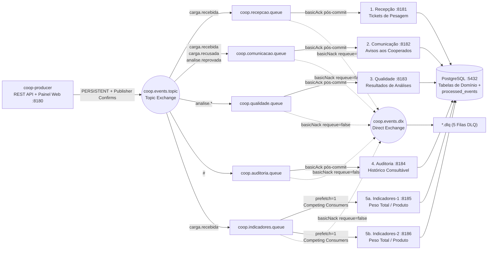

# Cooperativa Agrícola — Mensageria Orientada a Eventos com RabbitMQ

- **Disciplina:** Sistemas Distribuídos e Cloud Computing
- **Tema:** Tema 08 — Cooperativa Agrícola (Trabalho Final de Mensageria com RabbitMQ)
- **Nome do Grupo:** Grupo 08 — Cooperativa Agrícola
- **Integrantes:**
  - Ryan Tofanini — RA: 269204
  - João Felipe Lorenzon de Faria — RA: 268756
  - João Pedro Rodrigues Alves — RA: 269476
  - Matheus Aparecido Andrade Moraes — RA: 269648
  - Luis Gustavo Sciarini Marins — RA: 267483

---

## 1. Documentação da Solução

### 1.1. Visão Geral e Diagrama da Arquitetura

O sistema registra o recebimento de cargas agrícolas e o resultado das análises de qualidade de cada lote. A aplicação produtora (`coop-producer`) publica eventos de domínio em formato JSON na `TopicExchange` **`coop.events.topic`** no RabbitMQ, e cinco responsabilidades de consumo independentes reagem conforme suas regras de roteamento.



### 1.2. Módulos do Repositório

| Módulo / Arquivo | Papel | Porta |
|---|---|---|
| [`coop-common`](coop-common) | Contrato JSON (`CooperativeEvent`, `EventPayload`), constantes da topologia, `CooperativeRabbitConfig`, `ProcessedEventRepository`, `ReliableEventConsumer` e migração Flyway `V1__init_schema.sql` | — |
| [`coop-producer`](coop-producer) | API REST produtora de eventos, republicação idempotente e Painel Web interativo | `8180` |
| [`coop-consumer-recepcao`](coop-consumer-recepcao) | Consumidor 1 — Registra tickets de pesagem (`lote` e `pesoLiquidoKg`) | `8181` |
| [`coop-consumer-comunicacao`](coop-consumer-comunicacao) | Consumidor 2 — Registra avisos de recebimento, recusa de carga e reprovação em análise | `8182` |
| [`coop-consumer-qualidade`](coop-consumer-qualidade) | Consumidor 3 — Registra resultados das análises da família `analise.*` | `8183` |
| [`coop-consumer-auditoria`](coop-consumer-auditoria) | Consumidor 4 — Mantém histórico consultável por `eventId`, `eventType` e horário | `8184` |
| [`coop-consumer-indicadores`](coop-consumer-indicadores) | Consumidor 5 — Soma peso líquido recebido por produto (2 instâncias simultâneas) | `8185` / `8186` |
| [`rabbitmq/definitions.json`](rabbitmq/definitions.json) | Exportação versionada da topologia RabbitMQ (`vhosts`, `policies`, `exchanges`, `queues` e `bindings`), **sem credenciais/segredos** | `5672` / `15672` |

### 1.3. Matriz Evento × Consumidor

| Evento | `eventType` | `routingKey` | 1. Recepção (`carga.recebida`) | 2. Comunicação (`carga.recebida`, `carga.recusada`, `analise.reprovada`) | 3. Qualidade (`analise.*`) | 4. Auditoria (`#`) | 5. Indicadores (`carga.recebida`) |
|---|---|---|:---:|:---:|:---:|:---:|:---:|
| **Carga recebida** | `CARGA_RECEBIDA` | `carga.recebida` | **SIM** | **SIM** | NÃO | **SIM** | **SIM** *(1 instância)* |
| **Carga recusada** | `CARGA_RECUSADA` | `carga.recusada` | NÃO | **SIM** | NÃO | **SIM** | NÃO |
| **Análise aprovada** | `ANALISE_APROVADA` | `analise.aprovada` | NÃO | NÃO | **SIM** | **SIM** | NÃO |
| **Análise reprovada** | `ANALISE_REPROVADA` | `analise.reprovada` | NÃO | **SIM** | **SIM** | **SIM** | NÃO |
| *Novo evento na família* (ex.) | `ANALISE_REAVALIADA` | `analise.reavaliada` | NÃO | NÃO | **SIM** | **SIM** | NÃO |
| *Evento sem regra específica* (ex.) | `FATURAMENTO_EMITIDO` | `faturamento.emitido` | NÃO | NÃO | NÃO | **SIM** | NÃO |

### 1.4. Exemplo do Contrato de Evento em JSON

Todos os eventos seguem o contrato `CooperativeEvent`:

```json
{
  "eventId": "f47ac10b-58cc-4372-a567-0e02b2c3d479",
  "eventType": "CARGA_RECEBIDA",
  "routingKey": "carga.recebida",
  "occurredAt": "2026-11-24T13:30:00Z",
  "payload": {
    "lote": "LOTE-2026-001",
    "cooperado": "Fazenda Boa Vista",
    "produto": "SOJA",
    "pesoLiquidoKg": 18500.50,
    "motivo": null,
    "detalhes": {
      "origem": "unidade-central"
    }
  }
}
```

- **`eventId`**: identificador único do evento (gerado como UUID ou informado manualmente para repetir o mesmo ID no teste de duplicidade).
- **`eventType`**: tipo do evento (`String` extensível para aceitar novos fatos sem quebrar desserialização).
- **`routingKey`**: chave hierárquica `<processo>.<fato>` usada pela `Topic Exchange`.
- **`occurredAt`**: timestamp ISO-8601 UTC da ocorrência.
- **`payload`**: dados necessários aos efeitos (`lote`, `cooperado`, `produto`, `pesoLiquidoKg`, `motivo` e mapa extensível `detalhes`).

### 1.5. Justificativa das Decisões de Roteamento e Comparação de Exchanges

Escolheu-se uma **Topic Exchange (`coop.events.topic`, durável)** combinada a chaves no padrão `<processo>.<fato>`, com **Dead Letter Exchange (`coop.events.dlx`)** e políticas versionadas em [`rabbitmq/definitions.json`](rabbitmq/definitions.json) (`coop-queue-protection` e `coop-dlq-retention`).

#### Comparação com duas alternativas estudadas em aula

| Critério | **Topic Exchange** *(Escolhida)* | **Direct Exchange** *(Alternativa 1)* | **Fanout Exchange** *(Alternativa 2)* |
|---|---|---|---|
| **Seleção por evento** | **Atende nativamente** por chaves literais (`carga.recebida`, `carga.recusada`, `analise.reprovada`). | **Atende nativamente** por igualdade exata. | **Não atende.** Entrega tudo para todas as filas, exigindo descarte na aplicação. |
| **Acompanhamento de uma família** | **Atende nativamente** com curinga `analise.*` na fila de Qualidade, capturando novos fatos da família sem mexer no broker. | **Não atende nativamente.** Exigiria cadastrar manualmente um novo binding para cada novo evento da família. | **Não atende.** Qualidade receberia também eventos `carga.*`. |
| **Recebimento abrangente** | **Atende nativamente** com curinga `#` na fila de Auditoria (`coop.auditoria.queue`). | **Não atende nativamente.** Teria de replicar todos os bindings existentes e futuros na Auditoria. | **Atende nativamente** (*broadcast* total), mas inviabiliza os dois critérios anteriores na mesma exchange. |

#### Comportamento diante de eventos novos
- **Evento novo pertencente a uma família já acompanhada** (ex.: `analise.reavaliada`): o binding `analise.*` roteia automaticamente para `coop.qualidade.queue` e o binding `#` roteia para `coop.auditoria.queue`, sem alterar código ou bindings. Os demais consumidores não recebem.
- **Evento novo que não atende a nenhuma regra específica de negócio** (ex.: `faturamento.emitido`): apenas a Auditoria (`#`) recebe o evento. Caso não existisse a fila `#`, a `Topic Exchange` descartaria a mensagem sem rota — e, como o produtor publica com `mandatory=true` e `ReturnsCallback`, o broker notificaria o retorno da mensagem não roteada ao produtor.

Documentação técnica complementar:
- [`docs/arquitetura-e-justificativa.md`](docs/arquitetura-e-justificativa.md) — justificativa aprofundada e comparação arquitetural.
- [`docs/ecossistema-e-logica-detalhada.md`](docs/ecossistema-e-logica-detalhada.md) — explicação detalhada da lógica de cada classe, banco e container.
- [`docs/roteiro-de-slides.md`](docs/roteiro-de-slides.md) — guia completo para montagem dos slides e apresentação em 20 minutos.

---

## 2. Preparação do Ambiente e Configurações do RabbitMQ

### 2.1. Credenciais fora do repositório (`.env`)

Nenhuma senha, token ou hash de usuário está versionado no repositório (inclusive [`rabbitmq/definitions.json`](rabbitmq/definitions.json) contém **apenas** `vhosts`, `policies`, `exchanges`, `queues` e `bindings`).

Antes de iniciar, crie o arquivo local `.env` (ignorado pelo `.gitignore`) a partir do modelo [`.env.example`](.env.example):

```powershell
Copy-Item .env.example .env
```

Edite `.env` definindo credenciais de demonstração locais (`RABBITMQ_USER`, `RABBITMQ_PASSWORD`, `DB_USER`, `DB_PASSWORD`).

### 2.2. Como importar `rabbitmq/definitions.json` em uma instância limpa do RabbitMQ

1. **Pelo Painel Web (RabbitMQ Management UI):**
   - Suba uma instância limpa com plugin de gerenciamento (ex.: `docker run -d --name rmq-limpo -p 5672:5672 -p 15672:15672 -e RABBITMQ_DEFAULT_USER=<usuario> -e RABBITMQ_DEFAULT_PASS=<senha> rabbitmq:3-management-alpine`).
   - Acesse **http://localhost:15672** com o usuário e a senha definidos.
   - Na aba **Overview**, role até **Import definitions**, selecione o arquivo [`rabbitmq/definitions.json`](rabbitmq/definitions.json) e clique em **Upload definitions**.
2. **Ou via API HTTP (`curl`) em uma instância limpa:**
   ```powershell
   curl.exe -u "<RABBITMQ_USER>:<RABBITMQ_PASSWORD>" -X POST -H "Content-Type: application/json" --data-binary "@rabbitmq/definitions.json" http://localhost:15672/api/definitions
   ```
3. **Ou via Docker Compose deste projeto (importação automática):**
   - O serviço `rabbitmq-init` no [`compose.yaml`](compose.yaml) aguarda o broker ficar saudável e importa automaticamente [`rabbitmq/definitions.json`](rabbitmq/definitions.json) via `POST /api/definitions` usando as credenciais locais de `.env`.

---

## 3. Como Iniciar Produtor, Consumidores e Publicar os 4 Eventos

### 3.1. Execução completa no Docker Desktop (recomendado)

```powershell
docker compose up -d --build --wait
```

Serviços iniciados:
- **Painel Web + Produtor REST:** http://localhost:8180
- **RabbitMQ Management UI:** http://localhost:15672 *(credenciais do `.env`)*
- **Consumidores:** Recepção (`:8181`), Comunicação (`:8182`), Qualidade (`:8183`), Auditoria (`:8184`), Indicadores-1 (`:8185`) e Indicadores-2 (`:8186`).

### 3.2. Execução independente dos processos Java locais

Se preferir rodar apenas o RabbitMQ e o PostgreSQL no Docker e iniciar cada aplicação Java separadamente (exportando as variáveis do `.env` no shell ou usando `scripts/start-all.ps1`):

```powershell
# Sobe apenas infraestrutura e importa definitions.json no RabbitMQ
docker compose up -d --wait rabbitmq rabbitmq-init postgres

# Compila os módulos
.\mvnw.cmd clean package -DskipTests

# Forma rápida (carrega .env e inicia os 7 processos independentes)
.\scripts\start-all.ps1
```

Ou iniciando manualmente cada aplicação em terminais independentes (após carregar as variáveis de `.env`):

```powershell
java -jar coop-producer\target\coop-producer-1.0.0.jar
java -jar coop-consumer-recepcao\target\coop-consumer-recepcao-1.0.0.jar
java -jar coop-consumer-comunicacao\target\coop-consumer-comunicacao-1.0.0.jar
java -jar coop-consumer-qualidade\target\coop-consumer-qualidade-1.0.0.jar
java -jar coop-consumer-auditoria\target\coop-consumer-auditoria-1.0.0.jar
java -jar coop-consumer-indicadores\target\coop-consumer-indicadores-1.0.0.jar --server.port=8185 --coop.instance-id=indicadores-1
java -jar coop-consumer-indicadores\target\coop-consumer-indicadores-1.0.0.jar --server.port=8186 --coop.instance-id=indicadores-2
```

### 3.3. Como publicar os quatro eventos do cenário

Você pode disparar pelos **4 botões coloridos do Painel Web (`http://localhost:8180`)** ou via `curl`:

```powershell
# 1) Carga recebida
curl.exe -s -X POST http://localhost:8180/api/eventos/carga-recebida -H "Content-Type: application/json" -d "{\"eventId\":\"evt-demo-1\",\"lote\":\"LOTE-101\",\"cooperado\":\"Fazenda Boa Vista\",\"produto\":\"SOJA\",\"pesoLiquidoKg\":12500.00}"

# 2) Carga recusada
curl.exe -s -X POST http://localhost:8180/api/eventos/carga-recusada -H "Content-Type: application/json" -d "{\"lote\":\"LOTE-102\",\"cooperado\":\"Sitio Esperanca\",\"produto\":\"MILHO\",\"motivo\":\"Umidade acima do limite\"}"

# 3) Análise aprovada
curl.exe -s -X POST http://localhost:8180/api/eventos/analise-aprovada -H "Content-Type: application/json" -d "{\"lote\":\"LOTE-101\",\"produto\":\"SOJA\"}"

# 4) Análise reprovada
curl.exe -s -X POST http://localhost:8180/api/eventos/analise-reprovada -H "Content-Type: application/json" -d "{\"lote\":\"LOTE-103\",\"cooperado\":\"Estancia Santa Helena\",\"produto\":\"TRIGO\",\"motivo\":\"Micotoxina acima do limite\"}"
```

---

## 4. Roteiro para Reproduzir os Testes

### Execução automatizada completa
- **Testes unitários:** `.\mvnw.cmd test`
- **Bateria ponta a ponta (Docker):** `.\scripts\verify-e2e.ps1 -Mode Docker -KeepRunning`
- **Bateria ponta a ponta (Processos locais):** `.\scripts\verify-e2e.ps1 -Mode Local`

### Passo a passo manual

#### 4.1. Verificar roteamento dos quatro eventos e seus efeitos
Após publicar cada evento da seção 3.3, compare com a matriz consultando os endpoints (ou observando ao vivo no Painel Web `http://localhost:8180` e na aba **Queues** do RabbitMQ `http://localhost:15672`):
- **1. Recepção** (recebe apenas `carga.recebida`): `GET http://localhost:8181/api/recepcao/tickets`
- **2. Comunicação** (recebe `carga.recebida`, `carga.recusada`, `analise.reprovada`): `GET http://localhost:8182/api/comunicacao/avisos`
- **3. Qualidade** (recebe `analise.*`): `GET http://localhost:8183/api/qualidade/analises`
- **4. Auditoria** (recebe `#`, consultável por `eventId`, `eventType`, `inicio` e `fim`): `GET http://localhost:8184/api/auditoria/eventos?eventType=CARGA_RECEBIDA`
- **5. Indicadores** (recebe apenas `carga.recebida`): `GET http://localhost:8185/api/indicadores/totais`

Para testar eventos novos via API:
```powershell
# Novo fato na família especializada -> apenas Qualidade e Auditoria
curl.exe -s -X POST http://localhost:8180/api/eventos/publicar -H "Content-Type: application/json" -d "{\"eventType\":\"ANALISE_REAVALIADA\",\"routingKey\":\"analise.reavaliada\",\"payload\":{\"lote\":\"LOTE-103\",\"produto\":\"TRIGO\",\"motivo\":\"Contraprova solicitada\"}}"

# Evento sem regra específica -> apenas Auditoria (#)
curl.exe -s -X POST http://localhost:8180/api/eventos/publicar -H "Content-Type: application/json" -d "{\"eventType\":\"FATURAMENTO_EMITIDO\",\"routingKey\":\"faturamento.emitido\",\"payload\":{\"lote\":\"LOTE-101\",\"produto\":\"SOJA\"}}"
```

#### 4.2. Divisão de trabalho entre as duas instâncias do 5º consumidor
Com `indicadores-1` (`:8185`) e `indicadores-2` (`:8186`) conectados à fila `coop.indicadores.queue` com `prefetch=1`, publique 6 cargas recebidas distintas (ou clique em **Disparar Lote Concorrente (6 cargas)** no Painel Web):

```powershell
1..6 | ForEach-Object {
  curl.exe -s -X POST http://localhost:8180/api/eventos/carga-recebida -H "Content-Type: application/json" -d "{`"lote`":`"LOTE-CONC-$_`",`"produto`":`"SOJA`",`"pesoLiquidoKg`":1000}"
}
curl.exe -s http://localhost:8185/api/indicadores/execucoes
```

O campo `eventosProcessadosPorInstancia` e a lista `execucoes` comprovam que ambas as instâncias dividiram as mensagens com exatamente 1 processamento por evento, enquanto `Recepção`, `Comunicação` e `Auditoria` também registraram todas as 6 cargas.

#### 4.3. Interrupção e recuperação de um consumidor (`Comunicação`)

```powershell
# 1) Parar apenas o consumidor de Comunicação
docker compose stop comunicacao          # ou: .\scripts\stop-comunicacao.ps1

# 2) Publicar um evento que Comunicação e outro consumidor devam receber
curl.exe -s -X POST http://localhost:8180/api/eventos/analise-reprovada -H "Content-Type: application/json" -d "{\"lote\":\"LOTE-RECUP\",\"cooperado\":\"Cooperado Teste\",\"produto\":\"SOJA\",\"motivo\":\"Teste consumidor offline\"}"

# 3) Verificar processamento imediato em Qualidade (:8183) e Auditoria (:8184)
#    e verificar no RabbitMQ UI (:15672) que coop.comunicacao.queue possui 0 consumidores e 1 mensagem Ready

# 4) Religar Comunicação e comprovar a retomada
docker compose start comunicacao         # ou: .\scripts\start-comunicacao.ps1
curl.exe -s http://localhost:8182/api/comunicacao/avisos
```

#### 4.4. Tratamento de duplicidade e comprovação do efeito único
Anote o peso atual de `SOJA` em `GET http://localhost:8185/api/indicadores/totais` e republique o mesmo evento `evt-demo-1` (da etapa 3.3) com o **mesmo `eventId`**:

```powershell
# Opção A — endpoint dedicado de republicação exata pelo eventId:
curl.exe -s -X POST http://localhost:8180/api/eventos/evt-demo-1/republicar

# Opção B — novo POST enviando explicitamente o mesmo eventId:
curl.exe -s -X POST http://localhost:8180/api/eventos/carga-recebida -H "Content-Type: application/json" -d "{\"eventId\":\"evt-demo-1\",\"lote\":\"LOTE-101\",\"cooperado\":\"Fazenda Boa Vista\",\"produto\":\"SOJA\",\"pesoLiquidoKg\":12500.00}"

# Comprovação de efeito único:
curl.exe -s http://localhost:8185/api/indicadores/totais
curl.exe -s http://localhost:8185/api/indicadores/execucoes
```

- **`/api/indicadores/totais`**: o `pesoTotalKg` e `totalCargas` permanecem inalterados (os `12500.00 kg` foram somados uma única vez).
- **`/api/indicadores/execucoes`**: exibe o registro `DUPLICADO_IGNORADO` indicando qual instância recebeu a cópia repetida e a descartou sem somar novamente, graças à tabela compartilhada `processed_events` (`PRIMARY KEY (consumer_name, event_id)` com `INSERT ... ON CONFLICT DO NOTHING`).

#### 4.5. Em que momento a mensagem é confirmada pelo consumidor
Todos os 5 consumidores utilizam `acknowledge-mode: manual` por meio de [`ReliableEventConsumer`](coop-common/src/main/java/com/example/cooperativa/common/messaging/ReliableEventConsumer.java):
1. Ao receber a mensagem, o listener abre uma transação no PostgreSQL via `TransactionTemplate`.
2. Dentro dessa transação, reivindica `(consumer_name, event_id)` em `processed_events` e persiste o efeito de domínio no banco.
3. **Somente após o `COMMIT` da transação no PostgreSQL** o método `channel.basicAck(deliveryTag, false)` é enviado ao RabbitMQ.
4. Se ocorrer falha transitória de banco (`DataAccessException`), ocorre *rollback* e o consumidor envia `basicNack(deliveryTag, false, true)` para reentrega segura; se a mensagem for inválida ou irrecuperável, envia `basicNack(deliveryTag, false, false)` encaminhando-a para a **DLQ** via `coop.events.dlx`.
