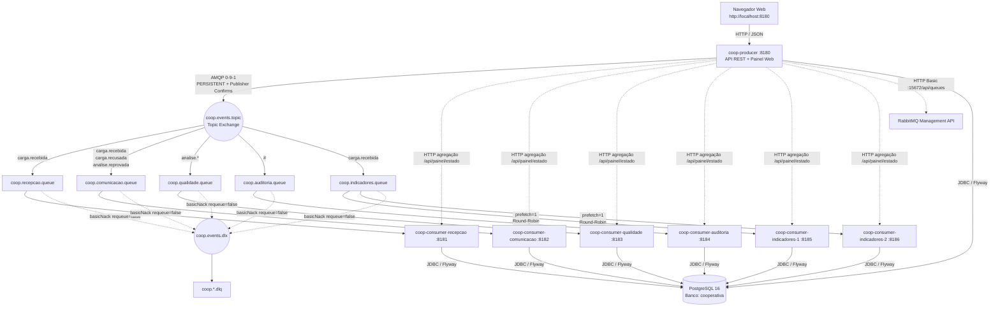

# Explicação Completa do Ecossistema e da Lógica de Funcionamento

Este documento descreve em profundidade toda a arquitetura, o fluxo de mensagens, o banco de dados, a lógica de cada módulo Java, o painel web de demonstração e os mecanismos que garantem **desacoplamento, entrega confiável, escalabilidade concorrente e idempotência**.

---

## 1. Visão Macro do Ecossistema

O sistema é composto por **9 containers** (ou 7 processos JVM locais + RabbitMQ + PostgreSQL):



### Princípio central de arquitetura
1. **Desacoplamento temporal e espacial:** o produtor (`coop-producer`) não sabe quais consumidores existem, quantas instâncias estão ligadas nem se algum consumidor está temporariamente fora do ar. Ele apenas publica eventos de domínio em `coop.events.topic` com uma `routingKey`.
2. **Processamento independente:** cada responsabilidade de consumo é uma aplicação Spring Boot isolada, com sua própria fila durável e seu próprio ciclo de vida (pode ser parada e iniciada individualmente via Docker Desktop ou scripts locais).
3. **Banco de dados e migrações unificadas (`Flyway`):** todas as aplicações conectam-se ao PostgreSQL `cooperativa`, utilizando tabelas separadas por domínio e uma tabela compartilhada de idempotência (`processed_events`), garantindo persistência durável e deduplicação mesmo entre instâncias concorrentes.

---

## 2. Módulo Comum (`coop-common`) — O Núcleo Compartilhado

O módulo `coop-common` é uma biblioteca JAR compartilhada pelos 6 serviços executáveis. Ele concentra **contrato JSON**, **topologia RabbitMQ**, **controle transacional de confirmação** e **migração do banco**.

### 2.1. Contrato JSON (`CooperativeEvent` e `EventPayload`)
Definidos como `record`s imutáveis do Java 21:
- **`CooperativeEvent`**:
  - `eventId` (`String`): identificador único do evento (UUID gerado automaticamente ou informado pelo chamador para testes de duplicidade).
  - `eventType` (`String`): nome semântico do fato (`CARGA_RECEBIDA`, `CARGA_RECUSADA`, `ANALISE_APROVADA`, `ANALISE_REPROVADA`, ou novos tipos como `ANALISE_REAVALIADA`).
  - `routingKey` (`String`): chave hierárquica `<processo>.<fato>` usada pelo broker para encaminhar a mensagem.
  - `occurredAt` (`Instant`): data/hora UTC da ocorrência do fato.
  - `payload` (`EventPayload`): `lote`, `cooperado`, `produto`, `pesoLiquidoKg`, `motivo` e `detalhes` (`Map<String, Object>` imutável e extensível).

**Por que `eventType` e `routingKey` são `String` (e não `enum` fechado)?**
Se `eventType` fosse um `enum` Java fechado, a publicação de um evento futuro da família de qualidade (ex.: `ANALISE_REAVALIADA` em `analise.reavaliada`) causaria erro de desserialização no consumidor de **Qualidade** ou **Auditoria**. Usando `String` + `Map<String, Object> detalhes`, o contrato permanece **retrocompatível e aberto à evolução**.

### 2.2. Conversor JSON e Topologia (`CooperativeRabbitConfig`)
- **Conversor (`JacksonJsonMessageConverter`):** utiliza o `JsonMapper` do Jackson 3 (padrão do Spring Boot 4.2) com `converter.setAlwaysConvertToInferredType(true)`. Isso faz com que o listener desserialize automaticamente qualquer JSON válido no tipo esperado pelo método (`CooperativeEvent`), inclusive mensagens enviadas manualmente pela interface web do RabbitMQ sem o header `__TypeId__`.
- **Declaração idempotente (`cooperativeTopologyDeclarables`):** declara `coop.events.topic` (`TopicExchange` durável), `coop.events.dlx` (`DirectExchange` durável), as 5 filas principais (cada uma configurada com `x-dead-letter-exchange = coop.events.dlx` e `x-dead-letter-routing-key = coop.<nome>.dlq`), as 5 filas DLQ e os 12 bindings. Isso espelha exatamente o arquivo [`rabbitmq/definitions.json`](../rabbitmq/definitions.json) carregado na inicialização do container RabbitMQ.

### 2.3. Confirmação Manual Pós-Commit (`ReliableEventConsumer`)
Todos os 5 consumidores operam com `spring.rabbitmq.listener.simple.acknowledge-mode: manual` e `default-requeue-rejected: false`. A lógica em `ReliableEventConsumer.handle(...)` segue rigorosamente esta ordem:

1. **Validação estrutural:** se `event` ou `event.eventId()` estiver vazio/nulo, executa imediatamente `channel.basicNack(deliveryTag, false, false)` para enviar a mensagem à DLQ sem travar a fila.
2. **Transação de banco (`TransactionTemplate`):** abre uma transação no PostgreSQL e executa a lógica do consumidor (`transactionalWork.run()`).
3. **`COMMIT` antes do `ACK`:** somente depois que `executeWithoutResult(...)` retorna normalmente (ou seja, o PostgreSQL já confirmou o `COMMIT`), o consumidor chama `channel.basicAck(deliveryTag, false)`.
4. **Tratamento de falhas:**
   - **`DataAccessException` (falha transitória de banco):** o `TransactionTemplate` desfaz a transação (`ROLLBACK`), o consumidor aguarda `500 ms` para evitar *busy loop* e chama `channel.basicNack(deliveryTag, false, true)` (`requeue=true`), devolvendo a mensagem para a fila para nova tentativa.
   - **Outras exceções (erro de contrato/negócio não recuperável):** faz `ROLLBACK` e chama `channel.basicNack(deliveryTag, false, false)` (`requeue=false`), acionando a **Dead Letter Exchange** (`coop.events.dlx`) que move a mensagem problemática para `coop.<consumidor>.dlq`.

### 2.4. Idempotência Compartilhada (`ProcessedEventRepository`)
Para evitar que entregas repetidas (seja por republicação com o mesmo `eventId`, seja por reentrega do broker após queda antes do `ACK`) dupliquem efeitos no sistema, todos os consumidores usam `tryClaimEvent(consumerName, eventId, instanceId)`:

```sql
INSERT INTO processed_events (consumer_name, event_id, instance_id)
VALUES (?, ?, ?)
ON CONFLICT (consumer_name, event_id) DO NOTHING
```

- A chave primária composta é `(consumer_name, event_id)`.
- O PostgreSQL garante atomicidade sob concorrência: se duas instâncias tentarem reivindicar o mesmo `(consumer_name, event_id)` ao mesmo tempo, apenas **uma** recebe `rows == 1` (`true`); a outra aguarda o desfecho da primeira transação e recebe `rows == 0` (`false`).
- **Detalhe técnico importante:** usar `INSERT ... ON CONFLICT DO NOTHING` via `JdbcTemplate` (participando da mesma transação gerenciada pelo Spring) evita lançar `DataIntegrityViolationException` dentro do Hibernate/JPA, o que marcaria a transação externa como `rollbackOnly` e impediria gravar o log de duplicidade (`DUPLICADO_IGNORADO` em `indicadores_execucoes` ou `delivery_count` em `auditoria_eventos`).

---

## 3. Modelo de Dados (`V1__init_schema.sql`)

Todas as tabelas residem no schema `public` do banco `cooperativa`:

| Tabela | Responsável | Finalidade e Restrições |
|---|---|---|
| `published_events` | `coop-producer` | Histórico dos eventos publicados (`event_id` PK) permitindo republicar exatamente o mesmo contrato JSON por `eventId`. |
| `processed_events` | `coop-common` (todos) | Controle atômico de idempotência por `(consumer_name, event_id)`. |
| `recepcao_tickets` | `coop-consumer-recepcao` | Tickets de pesagem (`lote`, `produto`, `cooperado`, `peso_liquido_kg`, `event_id` UNIQUE). |
| `comunicacao_avisos` | `coop-consumer-comunicacao` | Avisos aos cooperados (`tipo_aviso`: `RECEBIMENTO`, `RECUSA_CARGA`, `REPROVACAO_ANALISE`, `motivo`, `mensagem`). |
| `qualidade_resultados` | `coop-consumer-qualidade` | Laudos de análise (`event_type`, `routing_key`, `lote`, `resultado`, `motivo`, `detalhes_json`). |
| `auditoria_eventos` | `coop-consumer-auditoria` | Trilha integral com índices em `event_type` e `occurred_at`, além de `delivery_count`, `first_seen_at` e `last_seen_at`. |
| `indicadores_totais` | `coop-consumer-indicadores` | Agregado de `peso_total_kg` e `total_cargas` por `produto` (PK). |
| `indicadores_execucoes` | `coop-consumer-indicadores` | Auditoria de execução por instância (`instance_id`, `status`: `PROCESSADO` ou `DUPLICADO_IGNORADO`). |

---

## 4. Produtor e Painel Web (`coop-producer :8180`)

### 4.1. Publicação Confiável (`CooperativeEventPublisherService` + `RabbitProducerConfig`)
1. **Normalização e dados fictícios:** ao chamar `POST /api/eventos/carga-recebida`, `/carga-recusada`, `/analise-aprovada` ou `/analise-reprovada`, qualquer campo omitido recebe valores realistas (lote sequencial `LOTE-2026-XXX`, produto em maiúsculas como `SOJA`/`MILHO`/`TRIGO`/`CAFE`, cooperado e peso ou motivo padrão).
2. **Persistência idempotente no produtor:** registra o evento em `published_events` com `ON CONFLICT (event_id) DO NOTHING`, permitindo reenvio com `eventId` explícito sem erro de chave primária.
3. **Entrega persistente e confirmação do broker:**
   - Envia para `coop.events.topic` com `MessageDeliveryMode.PERSISTENT` (`delivery_mode = 2`, sobrevivendo a reinícios do RabbitMQ).
   - Configura `mandatory = true` e `ReturnsCallback` para detectar mensagens sem nenhuma fila roteável.
   - Usa `CorrelationData(eventId)` com `publisher-confirm-type: correlated` e aguarda até `5 segundos` pela confirmação (`confirm.ack()`), retornando `"brokerConfirmed": true` na resposta HTTP.
4. **Republicação pelo mesmo identificador:** `POST /api/eventos/{eventId}/republicar` busca o registro original em `published_events`, reconstrói exatamente o mesmo `CooperativeEvent` (`eventId`, `eventType`, `routingKey`, `occurredAt`, `payload`) e o republica no RabbitMQ para comprovar o tratamento de duplicidade.

### 4.2. Agregador e Interface Web (`PainelService`, `PainelController`, `static/*`)
- O produtor serve a interface estática em `http://localhost:8180/` (`index.html`, `styles.css`, `app.js` sem dependências externas/CDN).
- O endpoint `GET /api/painel/estado` (em `PainelService`) consulta em paralelo (`CompletableFuture.supplyAsync`, com *timeout* curto de 1,2s de conexão e 2,5s de leitura):
  1. Os endpoints de leitura e `/actuator/health` de todos os consumidores (`recepcao`, `comunicacao`, `qualidade`, `auditoria`, `indicadores-1`, `indicadores-2`).
  2. A API REST de gerenciamento do RabbitMQ (`/api/queues`, autenticada com as credenciais configuradas via `RABBITMQ_USER` / `RABBITMQ_PASSWORD` no `.env`), retornando `consumers`, `messagesReady` e `messagesUnacknowledged` de cada fila `coop.*`.
- Se um consumidor estiver desligado (ex.: `comunicacao` na Etapa 4), a falha de conexão HTTP é capturada localmente em `PainelService`, marcando apenas aquele serviço como `false` (`OFFLINE`) no mapa `servicos`, sem prejudicar a exibição dos demais serviços nem das filas pendentes no RabbitMQ.

---

## 5. Lógica Detalhada dos 5 Consumidores

### 5.1. Recepção (`coop-consumer-recepcao :8181`)
- **Binding:** `carga.recebida` → recebe exclusivamente eventos de carga recebida.
- **Lógica:** reivindica `("recepcao", eventId, "recepcao-1")`. Se inédito, valida a presença obrigatória de `lote` e `pesoLiquidoKg` (lançando `IllegalArgumentException` caso ausentes, o que envia à DLQ) e persiste o ticket em `recepcao_tickets`.
- **Consulta:** `GET /api/recepcao/tickets`.

### 5.2. Comunicação com Cooperados (`coop-consumer-comunicacao :8182`)
- **Bindings:** `carga.recebida`, `carga.recusada`, `analise.reprovada`.
- **Lógica:** reivindica `("comunicacao", eventId, "comunicacao-1")`. Traduz o evento em um aviso textual amigável com `tipoAviso`:
  - `CARGA_RECEBIDA` → `RECEBIMENTO`
  - `CARGA_RECUSADA` → `RECUSA_CARGA` (inclui `motivo`)
  - `ANALISE_REPROVADA` → `REPROVACAO_ANALISE` (inclui `motivo`)
- **Resiliência (Etapa 4):** quando esse container/processo é parado, sua fila durável `coop.comunicacao.queue` continua recebendo mensagens persistentes publicadas em `coop.events.topic`. Ao religá-lo, o RabbitMQ entrega imediatamente as mensagens acumuladas.
- **Consulta:** `GET /api/comunicacao/avisos`.

### 5.3. Qualidade (`coop-consumer-qualidade :8183`)
- **Binding:** `analise.*` → recebe `analise.aprovada`, `analise.reprovada` e qualquer novo fato dessa família (ex.: `analise.reavaliada`).
- **Lógica:** reivindica `("qualidade", eventId, "qualidade-1")`. A função `derivarResultado(eventType)` converte `ANALISE_APROVADA` em `"APROVADA"`, `ANALISE_REPROVADA` em `"REPROVADA"` e, para eventos novos do padrão `ANALISE_<X>`, extrai `<X>` dinamicamente (ex.: `ANALISE_REAVALIADA` → `"REAVALIADA"`). Serializa `payload.detalhes` em `detalhes_json` e persiste `lote` e `motivo`.
- **Consulta:** `GET /api/qualidade/analises`.

### 5.4. Auditoria da Cooperativa (`coop-consumer-auditoria :8184`)
- **Binding:** `#` → recebe todos os eventos publicados em `coop.events.topic`, independentemente da família ou de haver consumidor específico.
- **Lógica:**
  - Na primeira entrega (`tryClaimEvent == true`), insere o registro completo em `auditoria_eventos` com `delivery_count = 1`.
  - Em republicações duplicadas (`tryClaimEvent == false`), não duplica a linha do histórico; apenas incrementa `delivery_count = delivery_count + 1` e atualiza `last_seen_at`.
  - Na consulta (`GET /api/auditoria/eventos`), monta predicados dinâmicos via JPA `Specification` apenas para os filtros preenchidos (`eventId`, `eventType` *case-insensitive*, `inicio` e `fim` sobre `occurredAt`), evitando erros de tipagem de parâmetros nulos no driver JDBC do PostgreSQL.

### 5.5. Indicadores de Recepção (`coop-consumer-indicadores :8185` e `:8186`)
- **Binding:** `carga.recebida`.
- **Competição entre instâncias (*Competing Consumers*):** duas instâncias independentes (`INSTANCE_ID=indicadores-1` na porta `8185` e `INSTANCE_ID=indicadores-2` na porta `8186`) conectam-se à **mesma fila** `coop.indicadores.queue`.
- **Por que `prefetch: 1`?** Sem `prefetch=1`, o Spring AMQP usa *prefetch* padrão elevado (250), fazendo com que uma única instância possa drenar lotes inteiros antes da outra receber trabalho. Com `prefetch: 1`, o RabbitMQ entrega no máximo 1 mensagem não confirmada por vez para cada consumidor e distribui mensagens sequenciais entre `indicadores-1` e `indicadores-2`.
- **Idempotência distribuída e segurança contra concorrência:**
  1. Mesmo que `indicadores-1` processe o evento `E1` e uma republicação de `E1` seja entregue pelo RabbitMQ para `indicadores-2`, ambas consultam a mesma tabela `processed_events` com `consumer_name = "indicadores"`.
  2. `indicadores-2` recebe `false` de `tryClaimEvent`, **não** altera `indicadores_totais`, grava uma linha em `indicadores_execucoes` com `status = "DUPLICADO_IGNORADO"` e envia `basicAck`.
  3. Quando duas cargas distintas do mesmo produto (ex.: `SOJA`) chegam simultaneamente às duas instâncias, a soma usa uma operação atômica no PostgreSQL:
     ```sql
     INSERT INTO indicadores_totais (produto, peso_total_kg, total_cargas, atualizado_em)
     VALUES (?, ?, 1, ?)
     ON CONFLICT (produto) DO UPDATE
     SET peso_total_kg = indicadores_totais.peso_total_kg + EXCLUDED.peso_total_kg,
         total_cargas = indicadores_totais.total_cargas + 1,
         atualizado_em = EXCLUDED.atualizado_em
     ```
     Isso elimina completamente condições de corrida (*lost updates*) que ocorreriam com leitura-modificação-escrita em JPA.
- **Consultas:** `GET /api/indicadores/totais` e `GET /api/indicadores/execucoes`.

---

## 6. Empacotamento Docker (`Dockerfile` e `compose.yaml`)

- **`Dockerfile` multi-stage e multi-target:**
  - Estágio `builder` (`maven:3.9.9-eclipse-temurin-21`): compila e empacota todo o reator Maven usando cache persistente do BuildKit (`--mount=type=cache,target=/root/.m2`).
  - Estágio `runtime-base` (`eclipse-temurin:21-jre-alpine`): cria o usuário sem privilégios `coop` e gera 6 imagens enxutas (`producer`, `recepcao`, `comunicacao`, `qualidade`, `auditoria`, `indicadores`).
- **Orquestração (`compose.yaml`):**
  - `rabbitmq` (`check_port_connectivity`) e `postgres` (`pg_isready`) sobem primeiro com volumes persistentes (`rabbitmq_data`, `postgres_data`).
  - `producer` aguarda `rabbitmq` e `postgres` saudáveis, executa a migração Flyway `V1__init_schema.sql` e expõe `/actuator/health`.
  - Os 6 containers consumidores aguardam `producer` saudável (evitando corrida na primeira inicialização do schema) e recebem hostnames internos da rede Docker (`RABBITMQ_HOST=rabbitmq`, `DB_HOST=postgres`), enquanto `producer` recebe as URLs internas dos consumidores para alimentar o painel web em `http://localhost:8180`.
